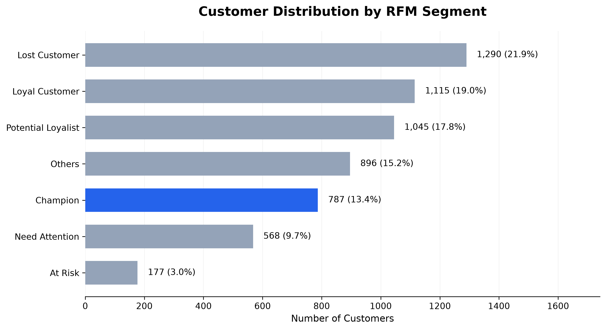
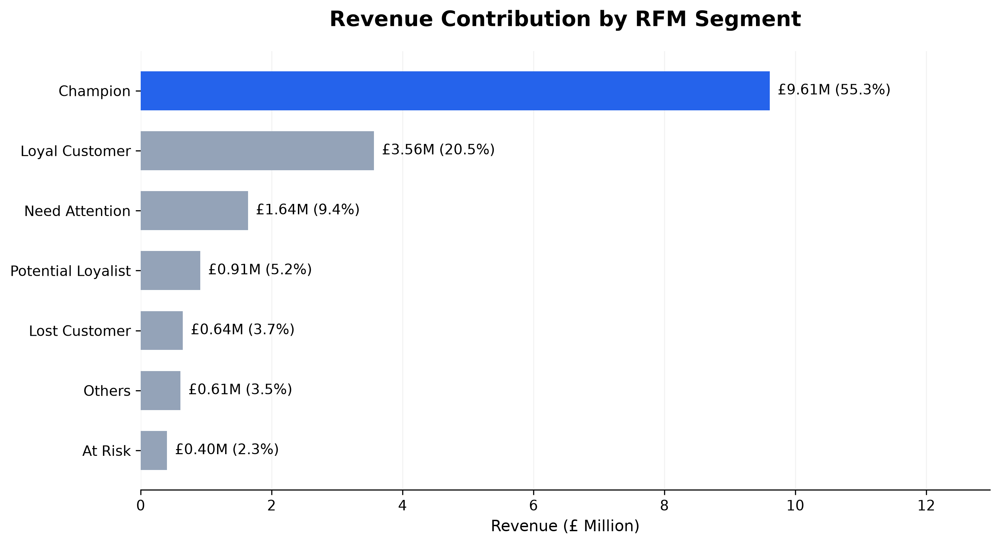

# E-commerce Customer Sales Analysis

Business-driven customer analytics project using Python, Exploratory Data Analysis (EDA), and RFM customer segmentation to identify purchasing patterns, revenue concentration, and actionable marketing opportunities.

**Google Data Analytics Professional Certificate — Capstone Project**

**Status:** Completed

## 🛠 Tech Stack

Python • Pandas • NumPy • Matplotlib • Seaborn • Jupyter Notebook • Git • GitHub

## 📊 Analytics Skills

Data Cleaning • Exploratory Data Analysis (EDA) • RFM Customer Segmentation • Customer Analytics • Business Intelligence • Data Visualization

## 🔄 Project Workflow

Dataset → Data Quality Assessment → Data Cleaning → Exploratory Data Analysis → RFM Customer Segmentation → Business Recommendations

## 📌 Project Overview

This project analyzes customer purchasing behavior and sales performance using the **Online Retail II** dataset, which contains transaction records from a UK-based online retailer.

The analysis combines sales performance evaluation, customer behavior analysis, and RFM-based segmentation to identify key revenue drivers and support evidence-based marketing decisions.

## 🎯 Business Objective

The primary objective is to identify opportunities to improve revenue performance and customer retention through transaction-level data analysis.

The project focuses on three analytical goals:

1. **Sales Performance:** Evaluate revenue trends, geographic distribution, and product contribution.
2. **Customer Behavior:** Understand customer purchasing activity, frequency, and historical spending.
3. **Marketing Strategy:** Segment customers based on RFM metrics and propose differentiated retention, growth, and reactivation strategies.

## ❓ Business Questions

This project addresses the following business questions:

- Which products generate the highest revenue?
- Which customers contribute the most sales?
- How does sales performance change over time?
- Which countries contribute the most revenue?
- How do purchasing patterns differ across customer segments?
- Which customer groups should be prioritized for retention and reactivation strategies?

## 📈 Project Summary

| Metric | Value |
|---|---:|
| Dataset | Online Retail II |
| Analysis Period | December 2009 – December 2011 |
| Original Transaction Rows | 1,067,371 |
| Rows After Cleaning | 1,028,001 |
| Countries Represented | 43 |
| RFM Customers Analyzed | 5,878 |
| RFM Revenue | £17,374,804.27 |
| Customer Segments | 7 |
| Champion Customers | 787 |
| Champion + Loyal Customer Share | 32.36% |
| Champion + Loyal Revenue Share | 75.82% |

**Key Finding:** Champion and Loyal Customers account for approximately one-third of the analyzed customer base but contribute more than three-quarters of RFM revenue.

*Note: The RFM metrics represent the customer-level analysis population and may differ from broader transaction-level EDA totals because of analysis-specific filtering and customer identification requirements.*

## 📁 Dataset Overview

This project uses the **Online Retail II** dataset, which contains transactional records from a UK-based online retail company.

The dataset covers transactions from **December 2009 to December 2011**, providing approximately two years of historical purchasing data for sales performance analysis, customer segmentation, and purchasing behavior analysis.

### Source

- **Dataset:** Online Retail II
- **Original Source:** UCI Machine Learning Repository
- **Download Platform:** Kaggle
- **Dataset Link:** https://www.kaggle.com/datasets/mashlyn/online-retail-ii-uci

### Key Variables

| Column | Description |
|---|---|
| Invoice | Unique transaction invoice number |
| InvoiceDate | Date and time of transaction |
| Customer ID | Unique customer identifier |
| StockCode | Product identifier |
| Description | Product description |
| Quantity | Number of units purchased |
| Price | Unit price (£) |
| Country | Customer country |

### Analysis Scope

The dataset supports three main analytical objectives:

- **Sales Performance:** Analyze revenue trends, geographic distribution, and product-level sales concentration.
- **Customer Segmentation:** Apply Recency, Frequency, and Monetary (RFM) analysis to identify customer groups.
- **Business Recommendations:** Develop customer retention, reactivation, and growth strategies based on historical purchasing behavior.


### Data Cleaning Summary

The Online Retail II dataset was cleaned and prepared through a multi-stage process to ensure data quality and consistency across sales performance and customer segmentation analyses.

**Data Preparation Steps**

- Removed 34,335 duplicate transaction records.
- Removed 4,275 records with missing product descriptions.
- Identified and separately preserved 760 non-sales candidate records.
- Converted `InvoiceDate` to datetime format.
- Validated transaction quantities and unit prices.
- Created the `Sales` feature using `Quantity × Price`.
- Prepared separate datasets for positive sales transactions and customer-level RFM analysis.

**Data Cleaning Results**

| Processing Stage | Records |
|---|---:|
| Raw Dataset | 1,067,371 |
| After Duplicate Removal | 1,033,036 |
| After Missing Description Removal | 1,028,761 |
| Non-Sales Candidates | 760 |
| Sales Base Dataset | 1,028,001 |
| Positive Sales Dataset | 1,007,913 |
| RFM Dataset | 779,425 |

**Data Quality Validation**

- The legacy cleaned dataset and the reconstructed V2 sales-base dataset both contain 1,028,001 records.
- Row-level consistency validation: **PASS**
- The two datasets contain identical transaction records after data type normalization and row sorting.
- The 760 non-sales candidate records are preserved separately for traceability.

### Data Files

```text
data/
├── raw/
│   └── (download from Kaggle)
└── processed/
    ├── inventory_adjustments.csv
    ├── non_sales_candidates_v2.csv
    ├── online_retail_clean.csv
    ├── online_retail_cleaned_v2.csv
    ├── online_retail_positive_sales_v2.csv
    └── online_retail_rfm_v2.csv
```

The processed datasets are maintained separately to support reproducibility and analysis-specific filtering.

The legacy cleaned dataset is retained for backward compatibility, while the V2 datasets provide a more transparent separation of cleaning and analysis stages.

> The raw dataset is not included in this repository due to file size limitations. Please download it from the Kaggle link provided above.


## 📊 Exploratory Data Analysis

### 1. Sales Performance

**Analysis Purpose**

Examine monthly revenue, order volume, and average order value to identify sales trends and seasonal patterns.


**Key Findings**

- Sales increased over the analysis period, with noticeable seasonal fluctuations.
- Revenue peaked during the year-end holiday season.
- Revenue and order volume generally moved in the same direction.

**Business Implication**

Seasonal demand patterns can support inventory planning, promotional timing, and resource allocation.

### 2. Customer Activity

**Analysis Purpose**

Track monthly active customers to understand changes in customer participation over time.


**Key Findings**

- Active customer counts fluctuated across the analysis period.
- Customer activity increased during high-sales months.
- Periods with higher customer activity often coincided with stronger revenue performance, suggesting an association between customer participation and sales.

**Business Implication**

Monitoring active customers can help evaluate acquisition, engagement, and seasonal campaign performance. 

### 3. Geographic Analysis

**Analysis Purpose**

Compare sales performance across countries and identify major international markets.


Sales performance was compared across different countries to identify major international markets.

**Key Findings**

- The dataset contains transactions from 43 countries.
- The United Kingdom accounted for approximately 85.03% of total revenue in the previously reported EDA results.
- The visualization excludes the United Kingdom to provide a clearer comparison of the top 10 international markets.
- Several non-UK European markets demonstrated notable sales contributions.

**Business Implication**

Country-level performance can guide market prioritization, localized campaigns, and international expansion decisions.

### 4. Product Analysis

**Analysis Purpose**

Evaluate product performance using revenue, quantity sold, and cumulative sales contribution.


Product performance was evaluated using sales revenue, purchasing quantity, and cumulative contribution.

**Key Findings**

- Product revenue was highly concentrated among a relatively small subset of products.
- Approximately 21.9% of products accounted for 80% of aggregated product revenue.
- The findings suggest opportunities to prioritize high-performing products in inventory and merchandising decisions.

### EDA Summary

The exploratory analysis identified seasonal sales patterns, geographic revenue concentration, variations in customer activity, and uneven product-level revenue contributions.

These findings provide the foundation for the next stage of the project: segmenting customers according to their purchasing behavior and historical value.

## 👥 Customer Segmentation Analysis

### Analysis Purpose

RFM (Recency, Frequency, Monetary) analysis was conducted to segment customers based on historical purchasing behavior.

The objective was to identify high-value customer groups, understand customer value distribution, and support targeted retention and marketing strategies.

### RFM Overview

RFM analysis evaluates customer purchasing behavior using three metrics:

| Metric | Description |
|---|---|
| **Recency (R)** | Number of days since the customer's last purchase |
| **Frequency (F)** | Number of unique purchase invoices |
| **Monetary (M)** | Total historical purchase value (£) |

**Scoring Methodology**

- **Recency:** Quartile-based scoring from 1 to 4, with more recent customers receiving higher scores.
- **Frequency:** Fixed-threshold scoring from 1 to 4 based on purchase frequency.
- **Monetary:** Quartile-based scoring from 1 to 4, with higher-spending customers receiving higher scores.
- **Segmentation:** Rule-based customer classification using the combined Recency and Frequency scores.

### Customer Segment Distribution



A total of **5,878 customers** were classified into seven behavioral segments.

| Customer Segment | Customers | Customer Share |
|---|---:|---:|
| Lost Customer | 1,290 | 21.95% |
| Loyal Customer | 1,115 | 18.97% |
| Potential Loyalist | 1,045 | 17.78% |
| Others | 896 | 15.24% |
| Champion | 787 | 13.39% |
| Need Attention | 568 | 9.66% |
| At Risk | 177 | 3.01% |

### Revenue Contribution by Segment



Total revenue attributed to customers in the RFM analysis was **£17,374,804.27**.

| Customer Segment | Revenue Share |
|---|---:|
| Champion | 55.30% |
| Loyal Customer | 20.51% |
| Need Attention | 9.43% |
| Potential Loyalist | 5.23% |
| Lost Customer | 3.71% |
| Others | 3.50% |
| At Risk | 2.32% |

### Key Findings

- **Revenue Concentration:** Champion and Loyal Customer segments represented 32.36% of customers but contributed 75.82% of RFM revenue.
- **High-Value Customers:** Champion customers accounted for 13.39% of customers and generated 55.30% of revenue.
- **Reactivation Opportunities:** Lost Customers represented the largest segment (21.95%) but contributed only 3.71% of revenue, suggesting a need for selective, cost-effective reactivation.
- **Customer Development:** Potential Loyalists represented 17.78% of customers, indicating an opportunity to encourage repeat purchases.
- **Targeted Marketing:** Differences in historical purchasing behavior support segment-specific retention and engagement strategies.

**Analysis Limitation**

RFM segmentation is based on historical transactions and rule-based classification. Segment labels do not represent predicted churn probabilities or future customer lifetime value.


### Business Implication

The RFM analysis revealed a significant concentration of historical revenue among high-value customers.

**Champions and Loyal Customers represented 32.36% of the customer base but contributed 75.82% of RFM revenue.**

This finding supports a customer-centric marketing approach that prioritizes:

- **High-Value Customer Retention:** Maintain relationships with Champions and Loyal Customers through differentiated loyalty benefits and personalized engagement.
- **Customer Development:** Encourage Potential Loyalists to increase purchase frequency through targeted promotions and cross-selling.
- **Selective Reactivation:** Prioritize Need Attention, At Risk, and historically valuable Lost Customers for tailored reactivation campaigns.
- **Efficient Resource Allocation:** Allocate marketing resources according to historical customer value, engagement patterns, and expected campaign effectiveness.

## 💡 Business Recommendations

The following recommendations are derived from the exploratory data analysis and RFM segmentation results.

| Key Finding | Recommended Strategy | Expected Business Outcome |
|---|---|---|
| **Champions and Loyal Customers** contribute 75.82% of RFM revenue. | Strengthen loyalty programs through VIP rewards, exclusive offers, early product access, and personalized recommendations. | Support customer retention and long-term customer relationships. |
| **Lost Customers** represent the largest segment (21.95%) but contribute only 3.71% of revenue. | Implement selective win-back campaigns, prioritizing customers with higher historical purchase value. | Improve reactivation efficiency while controlling marketing costs. |
| **Potential Loyalists** represent 17.78% of customers. | Encourage repeat purchases through personalized promotions, product recommendations, and cross-selling. | Increase purchase frequency and develop future loyal customers. |
| **Need Attention and At Risk** customers show reduced recent engagement relative to their historical purchase frequency. | Develop targeted re-engagement campaigns based on purchasing history and customer value. | Support customer reactivation and reduce potential customer loss. |
| Sales exhibited seasonal fluctuations, including stronger year-end performance. | Align inventory planning, promotional campaigns, and operational resources with seasonal demand patterns. | Improve inventory planning and campaign timing. |
| Revenue was concentrated among a relatively small proportion of products. | Prioritize high-performing products and evaluate product bundles and cross-selling opportunities. | Support product portfolio optimization and potential AOV improvement. |
| The UK accounted for the dominant share of sales revenue. | Evaluate selected international markets using country-level revenue performance and additional market research. | Identify opportunities for localized marketing and market expansion. |

**Implementation Priority**

1. **Priority 1 — Retention:** Protect high-value Champions and Loyal Customers.
2. **Priority 2 — Development:** Increase engagement and repeat purchases among Potential Loyalists.
3. **Priority 3 — Reactivation:** Test selective win-back campaigns for inactive and at-risk customers.
4. **Priority 4 — Optimization:** Improve seasonal planning, product strategies, and international market prioritization.

**Note:** These recommendations are based on historical purchasing behavior. Their financial impact has not been experimentally validated.

## 🚀 Future Improvements

Future enhancements for this project may include:

- **Predictive Customer Lifetime Value (CLV):** Develop models to estimate future customer value rather than relying solely on historical spending.
- **Customer Churn Prediction:** Build machine learning models to identify customers with elevated churn risk.
- **Cohort and Retention Analysis:** Examine customer retention and repeat purchase behavior over time.
- **Marketing Campaign Evaluation:** Use A/B testing and campaign performance metrics to evaluate the effectiveness of retention and reactivation strategies.
- **Interactive Dashboards:** Develop Tableau or Power BI dashboards for ongoing sales and customer segment monitoring.
- **Sales Forecasting:** Apply time-series methods to estimate future demand and support inventory planning.

## 📁 Repository Structure

```text
ecommerce-customer-sales-analysis/
│
├── data/
│   ├── raw/
│   ├── processed/
│   │   ├── online_retail_clean.csv
│   │   ├── online_retail_cleaned_v2.csv
│   │   ├── online_retail_positive_sales_v2.csv
│   │   ├── online_retail_rfm_v2.csv
│   │   └── non_sales_candidates_v2.csv
│   └── README.md
│
├── notebooks/
│   ├── 04_rfm_analysis_review.ipynb
│   └── 05_business_recommendation.ipynb
│
├── images/
├── outputs/
│   └── figures/
│
├── README.md
├── LICENSE
└── .gitignore
```

**Note:** The structure above highlights the principal analysis files. Additional notebooks, documentation, and supporting directories may be included in the repository.

The raw Online Retail II dataset is not included due to file size limitations. Download it from the Kaggle source provided above.

## ▶ How to Run

1. Clone this repository to your local computer.
2. Download the Online Retail II dataset from the Kaggle link provided in the Dataset Overview section.
3. Place the downloaded dataset in the `data/raw/` directory.
4. Install the Python packages required by the notebooks.
5. Open the project in VS Code or Jupyter Notebook.
6. Run the analysis notebooks in sequence:
   - Data Understanding and Data Cleaning
   - Exploratory Data Analysis (EDA)
   - RFM Customer Segmentation
   - Business Recommendations
7. Review the generated figures and analytical outputs.

**Reproducibility Note:** The notebooks should be executed in the intended order because downstream analyses depend on datasets generated during earlier processing steps. Confirm that input and output paths match your local project structure.

## 📄 License

This project is licensed under the MIT License.

The Online Retail Ⅱ dataset is provided by the UCI Machine Learning Repository and distributed through Kaggle for educational purposes.

## 🙎‍♀️ Author 

**Yoonju Song**

Google Data Analytics Professional Certificate Capstone Project
- GitHub: https://github.com/yoonjusong-analytics
- LinkedIn: https://www.linkedin.com/in/yoonju-song/

## 🙏 Acknowledgements

- Google Data Analytics Professional Certificate
- UCI Machine Learning Repository
- Kaggle

