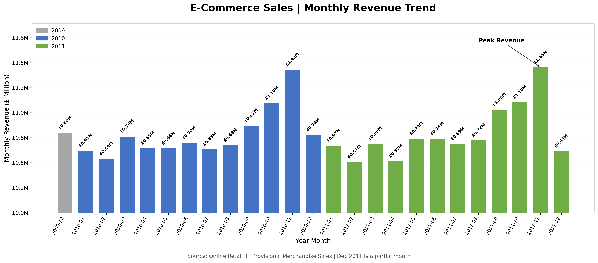
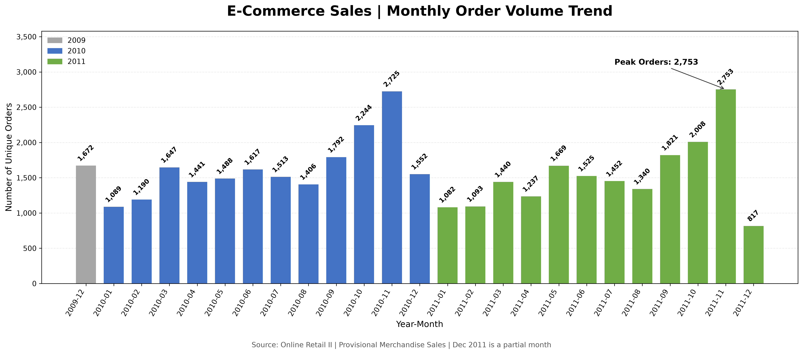
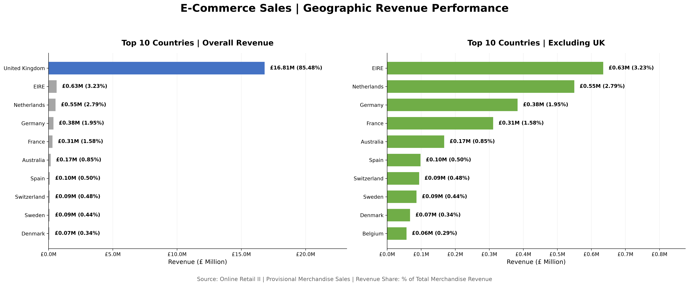
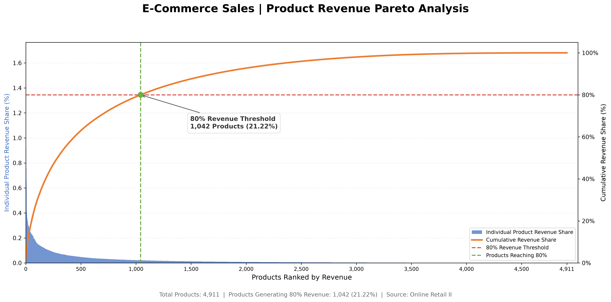

# E-commerce Customer Sales Analysis

Business-driven customer analytics project using Python, Exploratory Data Analysis (EDA), and RFM customer segmentation to identify purchasing patterns, revenue concentration, and actionable marketing opportunities.

**Google Data Analytics Professional Certificate — Capstone Project**

**Status:** Completed

## 🛠 Tech Stack

Python • Pandas • NumPy • Matplotlib • Seaborn • Jupyter Notebook • Git • GitHub

## 📊 Analytics Skills

Data Cleaning • Exploratory Data Analysis (EDA) • RFM Customer Segmentation • Customer Analytics • Business Intelligence • Data Visualization

## 🔄 Project Workflow

Dataset → Data Quality Assessment → Data Cleaning → Exploratory Data Analysis → RFM Customer Segmentation → Business Recommendations

## 📌 Project Overview

This project analyzes customer purchasing behavior and sales performance using the **Online Retail II** dataset, which contains transaction records from a UK-based online retailer.

The analysis combines sales performance evaluation, customer behavior analysis, and RFM-based segmentation to identify key revenue drivers and support evidence-based marketing decisions.

## 🎯 Business Objective

The primary objective is to identify opportunities to improve revenue performance and customer retention through transaction-level data analysis.

The project focuses on three analytical goals:

1. **Sales Performance:** Evaluate revenue trends, geographic distribution, and product contribution.
2. **Customer Behavior:** Understand customer purchasing activity, frequency, and historical spending.
3. **Marketing Strategy:** Segment customers based on RFM metrics and propose differentiated retention, growth, and reactivation strategies.

## ❓ Business Questions

This project addresses the following business questions:

- Which products generate the highest revenue?
- Which customers contribute the most sales?
- How does sales performance change over time?
- Which countries contribute the most revenue?
- How do purchasing patterns differ across customer segments?
- Which customer groups should be prioritized for retention and reactivation strategies?

## 📈 Project Summary

| Metric | Value |
|---|---:|
| Dataset | Online Retail II |
| Analysis Period | December 2009 – December 2011 |
| Original Transaction Rows | 1,067,371 |
| Rows After Cleaning | 1,028,001 |
| Countries Represented | 43 |
| RFM Customers Analyzed | 5,878 |
| RFM Revenue | £17,374,804.27 |
| Customer Segments | 7 |
| Champion Customers | 787 |
| Champion + Loyal Customer Share | 32.36% |
| Champion + Loyal Revenue Share | 75.82% |

**Key Finding:** Champion and Loyal Customers account for approximately one-third of the analyzed customer base but contribute more than three-quarters of RFM revenue.

*Note: The RFM metrics represent the customer-level analysis population and may differ from broader transaction-level EDA totals because of analysis-specific filtering and customer identification requirements.*

## 📁 Dataset Overview

This project uses the **Online Retail II** dataset, which contains transactional records from a UK-based online retail company.

The dataset covers transactions from **December 2009 to December 2011**, providing approximately two years of historical purchasing data for sales performance analysis, customer segmentation, and purchasing behavior analysis.

### Source

- **Dataset:** Online Retail II
- **Original Source:** UCI Machine Learning Repository
- **Download Platform:** Kaggle
- **Dataset Link:** https://www.kaggle.com/datasets/mashlyn/online-retail-ii-uci

### Key Variables

| Column | Description |
|---|---|
| Invoice | Unique transaction invoice number |
| InvoiceDate | Date and time of transaction |
| Customer ID | Unique customer identifier |
| StockCode | Product identifier |
| Description | Product description |
| Quantity | Number of units purchased |
| Price | Unit price (£) |
| Country | Customer country |

### Analysis Scope

The dataset supports three main analytical objectives:

- **Sales Performance:** Analyze revenue trends, geographic distribution, and product-level sales concentration.
- **Customer Segmentation:** Apply Recency, Frequency, and Monetary (RFM) analysis to identify customer groups.
- **Business Recommendations:** Develop customer retention, reactivation, and growth strategies based on historical purchasing behavior.


### Data Cleaning Summary

The Online Retail II dataset was cleaned and prepared through a multi-stage process to ensure data quality and consistency across sales performance and customer segmentation analyses.

**Data Preparation Steps**

- Removed 34,335 duplicate transaction records.
- Removed 4,275 records with missing product descriptions.
- Identified and separately preserved 760 non-sales candidate records.
- Converted `InvoiceDate` to datetime format.
- Validated transaction quantities and unit prices.
- Created the `Sales` feature using `Quantity × Price`.
- Prepared separate datasets for positive sales transactions and customer-level RFM analysis.

**Data Cleaning Results**

| Processing Stage | Records |
|---|---:|
| Raw Dataset | 1,067,371 |
| After Duplicate Removal | 1,033,036 |
| After Missing Description Removal | 1,028,761 |
| Non-Sales Candidates | 760 |
| Sales Base Dataset | 1,028,001 |
| Positive Sales Dataset | 1,007,913 |
| RFM Dataset | 779,425 |

**Analysis Dataset Definitions**

- **Sales Base Dataset (1,028,001 rows):** Cleaned transaction records retained after the primary data cleaning process.
- **Positive Sales Dataset (1,007,913 rows):** Transaction records selected for positive-sales analysis.
- **RFM Dataset (779,425 rows):** Positive sales transactions with valid Customer IDs, prepared for customer-level RFM analysis.

**RFM Dataset Filtering**

The RFM dataset was created by excluding 228,488 positive-sales records with missing Customer IDs.

This filtering ensures that each transaction included in the RFM analysis can be associated with an identifiable customer.

**Validation Criteria**

- Missing Customer IDs: 0
- Quantity > 0 for all RFM records
- Price > 0 for all RFM records

**Data Quality Validation**

- The legacy cleaned dataset and the reconstructed V2 sales-base dataset both contain 1,028,001 records.
- Row-level consistency validation: **PASS**
- The two datasets contain identical transaction records after data type normalization and row sorting.
- The 760 non-sales candidate records are preserved separately for traceability.

### Data Files

```text
data/
├── raw/
│   └── (download from Kaggle)
└── processed/
    ├── inventory_adjustments.csv
    ├── non_sales_candidates_v2.csv
    ├── online_retail_clean.csv
    ├── online_retail_cleaned_v2.csv
    ├── online_retail_positive_sales_v2.csv
    └── online_retail_rfm_v2.csv
```

The processed datasets are maintained separately to support reproducibility and analysis-specific filtering.

The legacy cleaned dataset is retained for backward compatibility, while the V2 datasets provide a more transparent separation of cleaning and analysis stages.

> The raw dataset is not included in this repository due to file size limitations. Please download it from the Kaggle link provided above.


## 📊 Exploratory Data Analysis

### 1. Sales Performance

**Analysis Purpose**

Examine monthly revenue trends to identify changes in sales performance, seasonal patterns, and peak revenue periods.



**Key Findings**

- Monthly revenue varied across the analysis period, indicating changes in sales performance over time.
- The visualization highlights the highest-revenue month and allows comparisons of monthly revenue across 2009, 2010, and 2011.
- December 2011 represents a partial month and should not be directly compared with complete months when evaluating sales trends.

**Business Implication**

Monthly revenue analysis can support seasonal demand assessment, promotional planning, and inventory allocation. Additional comparisons with order volume and average order value can help identify the drivers of revenue changes.

**Analysis Note**

Revenue is presented as provisional merchandise sales, consistent with the transaction-level sales definition used in the EDA Notebook.

### 2. Monthly Order Volume

**Analysis Purpose**

Analyze monthly unique order volume to understand changes in purchasing activity and compare order patterns across the analysis period.



**Key Findings**

- Monthly order volume was examined using the `Unique_Orders` metric.
- The visualization compares monthly order counts across 2009, 2010, and 2011 and highlights the month with the highest order volume.
- Monthly order volume provides an additional perspective on purchasing activity alongside monthly revenue.
- December 2011 represents a partial month and should not be directly compared with complete months.

**Business Implication**

Monthly order volume can support demand monitoring, promotional scheduling, and operational resource planning.

Comparing monthly orders with revenue and average order value can help assess whether revenue changes are associated with transaction volume or average spending per order.

**Order Volume Definition**

Monthly order volume is calculated as the number of unique invoice numbers (`Invoice.nunique()`) within each calendar month, using the provisional merchandise sales dataset.

Monthly Average Order Value (AOV) is calculated by dividing monthly revenue by the number of unique orders.

The analysis covers 25 calendar months from December 2009 to December 2011, with December 2011 representing a partial month.


### 3. Geographic Analysis

### 3. Geographic Analysis

**Analysis Purpose**

Compare country-level revenue performance to identify geographic sales concentration and major international markets.



**Analysis Methodology**

- Aggregated merchandise sales revenue by country.
- Calculated each country's revenue share relative to total merchandise revenue.
- Compared the top 10 countries by overall revenue with the top 10 countries excluding the United Kingdom.
- Measured unique invoices and transaction records to support country-level performance analysis.

**Key Findings**

- The United Kingdom accounted for approximately **85.48%** of total provisional merchandise revenue.
- The geographic revenue analysis revealed a high concentration of sales in the UK market.
- Among non-UK markets, EIRE (Ireland) and the Netherlands recorded the highest revenue contributions, followed by Germany and France.
- Comparing the overall top 10 countries with the UK-excluded top 10 provides a clearer view of international market performance.

**Business Implication**

Geographic revenue concentration highlights the importance of the UK market while identifying opportunities to evaluate selected international markets.

However, market expansion decisions should also consider market size, competition, customer acquisition costs, and operational feasibility.

### 4. Product Analysis

### 4. Product Analysis

**Analysis Purpose**

Evaluate product-level revenue performance, sales quantity, and revenue concentration to identify high-performing products and support product portfolio decisions.



**Analysis Methodology**

- Aggregated product revenue and sales quantity using `StockCode` as the product identifier.
- Ranked products by total revenue.
- Calculated individual and cumulative product revenue shares.
- Applied an 80% cumulative revenue threshold to evaluate revenue concentration.

**Key Findings**

- A total of **4,911 products** were included in the product revenue analysis.
- The top **1,042 products (21.22%)** accounted for approximately **80% of total product revenue**.
- Product revenue was concentrated among a relatively small proportion of the analyzed products.
- The results indicate opportunities to prioritize high-revenue products in inventory planning and merchandising strategies.

**Business Implication**

Product-level revenue concentration can support inventory prioritization, merchandising decisions, and product portfolio optimization.

However, revenue contribution alone does not indicate product profitability. Gross margin, inventory costs, and customer demand should also be considered before making product investment decisions.

### EDA Summary

The exploratory data analysis examined monthly revenue trends, order volume, geographic revenue distribution, and product-level sales concentration.

The analysis highlighted differences in monthly sales performance, substantial revenue concentration in the United Kingdom, and an uneven distribution of revenue across products.

These findings provide a foundation for understanding sales performance and identifying opportunities for demand planning, market prioritization, and product portfolio management.

The next stage of the project applies RFM customer segmentation to evaluate historical customer purchasing behavior and support differentiated marketing strategies.

## 👥 Customer Segmentation Analysis

### Analysis Purpose

RFM (Recency, Frequency, Monetary) analysis was conducted to segment customers based on historical purchasing behavior.

The objective was to identify high-value customer groups, understand customer value distribution, and support targeted retention and marketing strategies.

### RFM Overview

RFM analysis evaluates historical customer purchasing behavior using three metrics:

| Metric | Description |
|---|---|
| **Recency (R)** | Number of days since the customer's last purchase |
| **Frequency (F)** | Number of unique purchase invoices |
| **Monetary (M)** | Total historical purchase value (£) |

**Scoring Methodology**

- **Recency:** Quartile-based scoring from 1 to 4, with more recent customers receiving higher scores.
- **Frequency:** Rule-based scoring from 1 to 4 using predefined purchase-frequency thresholds.
- **Monetary:** Quartile-based scoring from 1 to 4, with higher-spending customers receiving higher scores.

**Frequency Scoring Criteria**

| F Score | Purchase Frequency |
|---|---|
| 1 | 1 purchase |
| 2 | 2–3 purchases |
| 3 | 4–6 purchases |
| 4 | 7 or more purchases |

**Customer Segmentation Method**

Customers were classified into seven segments using a rule-based mapping of combined Recency and Frequency scores (`RF_Score`).

Monetary scores were calculated separately to evaluate historical customer spending and support customer value analysis.

The segmentation process was validated to ensure that all 16 possible Recency–Frequency score combinations were mapped and that no customers remained without a segment assignment.

**Analysis Reference Date**

December 10, 2011, was used as the reference date for calculating customer Recency.

### Customer Segment Distribution


A total of **5,878 customers** were classified into seven behavioral segments.

| Customer Segment | Customers | Customer Share |
|---|---:|---:|
| Lost Customer | 1,290 | 21.95% |
| Loyal Customer | 1,115 | 18.97% |
| Potential Loyalist | 1,045 | 17.78% |
| Others | 896 | 15.24% |
| Champion | 787 | 13.39% |
| Need Attention | 568 | 9.66% |
| At Risk | 177 | 3.01% |

**Key Observations**

- **Lost Customer** is the largest segment, representing 21.95% of customers.
- **Loyal Customer** and **Potential Loyalist** account for 18.97% and 17.78%, respectively.
- **Champion** customers represent 13.39% of the customer base.
- The distribution demonstrates differences in historical purchase recency and frequency across customer segments.

**Business Interpretation**

Customer segment size alone does not indicate customer value. Revenue contribution and historical spending should also be considered when determining marketing priorities.

### Revenue Contribution by Segment


Total revenue attributed to customers in the RFM analysis was **£17,374,804.27**.

| Customer Segment | Revenue Share |
|---|---:|
| Champion | 55.30% |
| Loyal Customer | 20.51% |
| Need Attention | 9.43% |
| Potential Loyalist | 5.23% |
| Lost Customer | 3.71% |
| Others | 3.50% |
| At Risk | 2.32% |

**Revenue Concentration Insight**

Champion and Loyal Customers collectively represent 32.36% of the analyzed customer base but contribute 75.82% of total RFM revenue.

Champion customers alone account for 55.30% of revenue despite representing only 13.39% of customers.

This concentration highlights the importance of protecting relationships with historically high-value customers while evaluating selective development and reactivation opportunities across other segments.

**Analysis Note**

Revenue contribution reflects historical customer spending and should not be interpreted as predicted future revenue or customer lifetime value.

### Key Findings

- **Revenue Concentration:** Champion and Loyal Customer segments represented 32.36% of customers but contributed 75.82% of RFM revenue.
- **High-Value Customers:** Champion customers accounted for 13.39% of customers and generated 55.30% of revenue.
- **Reactivation Opportunities:** Lost Customers represented the largest segment (21.95%) but contributed only 3.71% of revenue, suggesting a need for selective, cost-effective reactivation.
- **Customer Development:** Potential Loyalists represented 17.78% of customers, indicating an opportunity to encourage repeat purchases.
- **Targeted Marketing:** Differences in historical purchasing behavior support segment-specific retention and engagement strategies.

**Analysis Limitation**

RFM segmentation is based on historical transactions and rule-based classification. Segment labels do not represent predicted churn probabilities or future customer lifetime value.


### Business Implication

The RFM analysis demonstrates that customer segments differ substantially in historical purchasing activity and revenue contribution.

These findings support a differentiated marketing approach rather than allocating resources solely according to customer segment size.

**Strategic Priorities**

- **High-Value Customer Retention:** Prioritize relationship management for Champion and Loyal Customers through differentiated loyalty benefits and personalized engagement.
- **Customer Development:** Encourage Potential Loyalists to increase purchase frequency through targeted promotions, relevant product recommendations, and cross-selling.
- **Selective Reactivation:** Evaluate Need Attention, At Risk, and historically valuable Lost Customers for tailored reactivation campaigns.
- **Efficient Resource Allocation:** Consider historical customer value, purchasing activity, and campaign costs when determining marketing priorities.

**Strategic Consideration**

These recommendations represent opportunities identified through historical transaction analysis. Campaign effectiveness and financial returns should be validated through subsequent testing and performance measurement.

## 💡 Business Recommendations

The following recommendations are derived from the exploratory data analysis and RFM segmentation results.

| Key Finding | Recommended Strategy | Intended Business Outcome |
|---|---|---|
| **Champions and Loyal Customers** contribute 75.82% of RFM revenue. | Strengthen loyalty programs through VIP rewards, exclusive offers, early product access, and personalized recommendations. | Support customer retention and long-term customer relationships. |
| **Lost Customers** represent the largest segment (21.95%) but contribute only 3.71% of revenue. | Implement selective win-back campaigns, prioritizing customers with higher historical purchase value. | Improve reactivation efficiency while controlling marketing costs. |
| **Potential Loyalists** represent 17.78% of customers. | Encourage repeat purchases through personalized promotions, product recommendations, and cross-selling. | Increase purchase frequency and develop future loyal customers. |
| **Need Attention and At Risk** customers show reduced recent engagement relative to their historical purchase frequency. | Develop targeted re-engagement campaigns based on purchasing history and customer value. | Support customer reactivation and reduce potential customer loss. |
| Sales exhibited seasonal fluctuations, including stronger year-end performance. | Align inventory planning, promotional campaigns, and operational resources with seasonal demand patterns. | Improve inventory planning and campaign timing. |
| Revenue was concentrated among a relatively small proportion of products. | Prioritize high-performing products and evaluate product bundles and cross-selling opportunities. | Support product portfolio optimization and potential AOV improvement. |
| The UK accounted for the dominant share of sales revenue. | Evaluate selected international markets using country-level revenue performance and additional market research. | Identify opportunities for localized marketing and market expansion. |

**Implementation Priority**

1. **Priority 1 — Retention:** Protect high-value Champions and Loyal Customers.
2. **Priority 2 — Development:** Increase engagement and repeat purchases among Potential Loyalists.
3. **Priority 3 — Reactivation:** Test selective win-back campaigns for inactive and at-risk customers.
4. **Priority 4 — Optimization:** Improve seasonal planning, product strategies, and international market prioritization.

**Recommendation Scope & Validation**

The proposed strategies are based on historical sales performance and RFM customer segmentation.

The implementation priorities represent an initial, data-informed recommendation rather than an experimentally validated allocation of marketing resources.

The intended business outcomes have not yet been measured. Future implementation should evaluate campaign response rates, incremental revenue, customer retention, and marketing costs through controlled testing and performance monitoring.


## 🚀 Future Improvements

Future enhancements for this project may include:

- **Predictive Customer Lifetime Value (CLV):** Develop models to estimate future customer value rather than relying solely on historical spending.
- **Customer Churn Prediction:** Build machine learning models to identify customers with elevated churn risk.
- **Cohort and Retention Analysis:** Examine customer retention and repeat purchase behavior over time.
- **Marketing Campaign Evaluation:** Use A/B testing and campaign performance metrics to evaluate the effectiveness of retention and reactivation strategies.
- **Interactive Dashboards:** Develop Tableau or Power BI dashboards for ongoing sales and customer segment monitoring.
- **Sales Forecasting:** Apply time-series methods to estimate future demand and support inventory planning.

## 📁 Repository Structure

```text
ecommerce-customer-sales-analysis/
│
├── dashboard/
│
├── data/
│   ├── raw/
│   │   ├── .gitkeep
│   │   └── online_retail_II.csv
│   │
│   ├── processed/
│   │   ├── inventory_adjustments.csv
│   │   ├── non_sales_candidates_v2.csv
│   │   ├── online_retail_clean.csv
│   │   ├── online_retail_cleaned_v2.csv
│   │   ├── online_retail_positive_sales_v2.csv
│   │   └── online_retail_rfm_v2.csv
│   │
│   └── README.md
│
├── docs/
│   ├── analysis_plan.md
│   ├── data_dictionary.md
│   └── project_workflow.md
│
├── images/
│   └── (EDA charts and visualizations)
│
├── notebooks/
│   ├── images/
│   ├── 01_data_quality_assessment.ipynb
│   ├── 02_data_cleaning.ipynb
│   ├── 04_rfm_analysis_review.ipynb
│   ├── 04_rfm_analysis.ipynb
│   ├── 05_business_recommendation.ipynb
│   └── README.md
│
├── outputs/
├── reports/
│   └── figures/
│
├── sql
├── .gitignore
├── LICENSE
└── README.md
```

**Repository Notes**

- The `data/processed/` directory contains intermediate and analysis-ready datasets generated during data preparation.
- The `notebooks/` directory contains the analysis workflow, including data quality assessment, cleaning, exploratory analysis, RFM segmentation, and business recommendations.
- The `images/`, `outputs/`, and `reports/figures/` directories contain or organize analytical visualizations and supporting outputs.
- The `docs/` directory provides project planning, workflow documentation, and data definitions.
- The repository structure reflects the local project workspace. Some files, particularly raw datasets and generated outputs, may be excluded from GitHub depending on `.gitignore` settings.

**Data Availability**

The Online Retail II dataset can be downloaded from the [Kaggle dataset page](https://www.kaggle.com/datasets/mashlyn/online-retail-ii-uci). The original dataset may not be included in the public repository due to file size limitations.

## ▶ How to Run

Follow the steps below to reproduce the analysis using Python and Jupyter Notebook.

**Step 1. Clone the Repository**

Clone this repository to your local computer and open the project directory in VS Code or Jupyter Notebook.

**Step 2. Download the Dataset**

Download the Online Retail II dataset from Kaggle:

https://www.kaggle.com/datasets/mashlyn/online-retail-ii-uci

Place the source CSV file in the following directory:

```text
data/raw/online_retail_II.csv
```

Ensure that the dataset filename and location match the file paths used in the notebooks.

**Step 3. Prepare the Python Environment**

Install the Python packages required for the analysis.

The primary libraries used in this project include:

- pandas
- numpy
- matplotlib
- seaborn
- jupyter

A Python environment with these dependencies is required to execute the notebooks.

**Step 4. Run the Notebooks in Sequence**

Execute the following notebooks in the order listed:

| Order | Notebook | Purpose |
|---|---|---|
| 1 | `01_data_quality_assessment.ipynb` | Assess source data quality and structure |
| 2 | `02_data_cleaning.ipynb` | Clean and prepare analysis datasets |
| 3 | `03_exploratory_data_analysis.ipynb` | Analyze sales trends, order volume, geographic performance, and product contribution |
| 4 | `04_rfm_analysis_review.ipynb` | Calculate RFM metrics and segment customers |
| 5 | `05_business_recommendation.ipynb` | Develop data-informed business recommendations |

**Step 5. Review Analytical Outputs**

Review the generated datasets, visualizations, and analytical results in the project directories.

Key output locations include:

- `data/processed/` — Cleaned and analysis-ready datasets
- `images/` — Exploratory data analysis visualizations
- `outputs/` — Additional analytical outputs
- `reports/figures/` — Supporting figures and reports

**Reproducibility Note**

The notebooks should be executed in the intended sequence because later analyses may depend on datasets generated during earlier processing steps.

File paths and package dependencies should be verified before execution. The analysis results reflect historical transaction data and do not represent real-time business performance.

## 📄 License

This project's original code and documentation are licensed under the MIT License. See the [LICENSE](LICENSE) file for details.

The Online Retail II dataset originates from the UCI Machine Learning Repository and is accessible through Kaggle.

The dataset is subject to its original licensing and usage terms, which are separate from this project's MIT License.

## 🙎‍♀️ Author

**Yoonju Song**

Google Data Analytics Professional Certificate — Capstone Project

- **GitHub:** https://github.com/yoonjusong-analytics
- **LinkedIn:** https://www.linkedin.com/in/yoonju-song/

## 🙏 Acknowledgements

- **Google Data Analytics Professional Certificate** — Educational framework for the capstone project.
- **UCI Machine Learning Repository** — Original source of the Online Retail II dataset.
- **Kaggle** — Dataset access platform.
